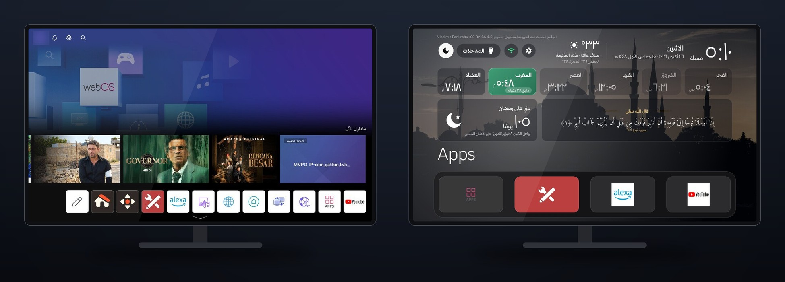
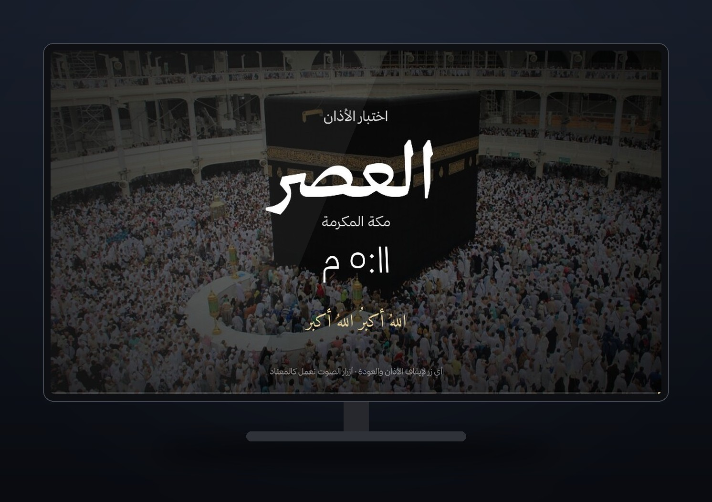
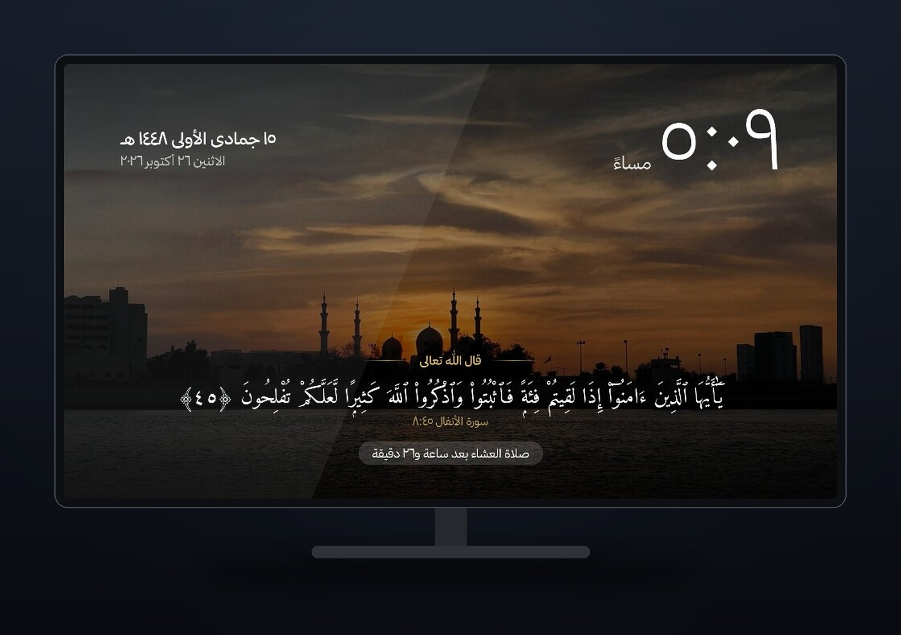
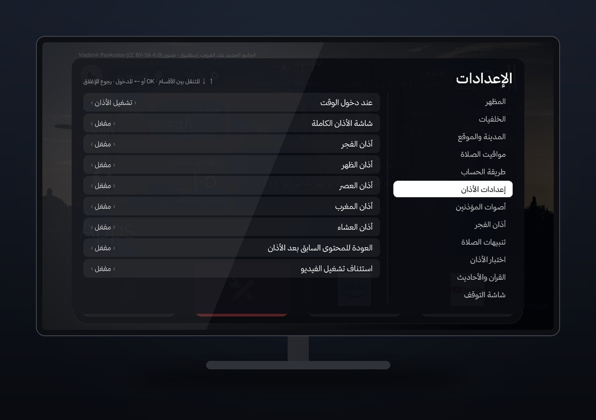
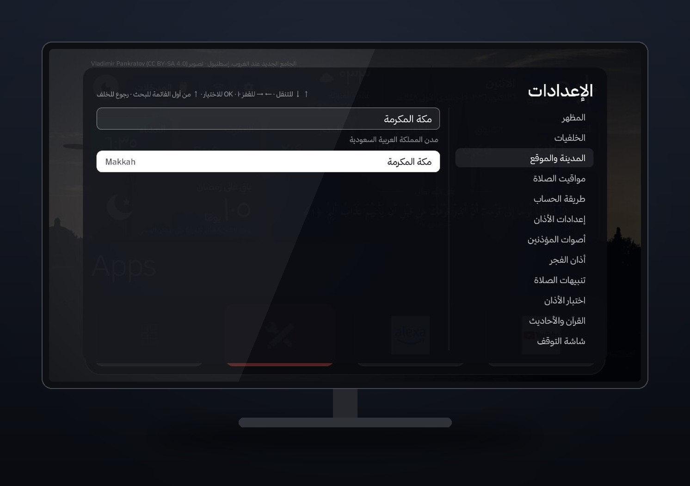

<div dir="rtl">

**العربية** · [English](README.en.md)

# Xee Launcher · واجهة إسلامية عربية لشاشات LG

واجهة رئيسية عربية نظيفة لشاشات LG بنظام webOS، **دون Root**، تستبدل الشاشة الرئيسية المليئة بالإعلانات بواجهة هادئة تشبه Apple TV بهوية عربية إسلامية: مواقيت الصلاة، والأذان التفاعلي، والقرآن الكريم، والأحاديث، وشاشة توقف، وخلفيات تتغير حسب وقت اليوم.

مبنية على مشروع [Clean Your TV](https://github.com/Razdva122/clean-your-tv-lg-webos) (ترخيص MIT) وتعمل عبر **وضع المطوّر الرسمي من LG** فقط، فلا تستغل أي ثغرة ولا تكسر حماية الشاشة.

> مُختبرة فعليًا على **LG 43UQ70006LB** (webOS 22، إصدار البرنامج 04.60.91). الموديلات الأخرى بنظام webOS 22 أو أحدث يُتوقع أن تعمل، لكنها غير مُتحقق منها.

<p align="center"></p>
<p align="center"><b>قبل</b>: واجهة LG الأصلية بإعلاناتها ومحتواها المروّج &nbsp;·&nbsp; <b>بعد</b>: الواجهة الجديدة</p>

<table>
<tr>
<td width="50%"><p align="center">شاشة الأذان، تظهر فوق أي تطبيق</p></td>
<td width="50%"><p align="center">شاشة التوقف</p></td>
</tr>
<tr>
<td width="50%"><p align="center">الإعدادات: 18 قسمًا بالعربية</p></td>
<td width="50%"><p align="center">اختيار المدينة دون إنترنت</p></td>
</tr>
</table>

## المميزات

**الشاشة الرئيسية**
- الساعة بنظام 12 ساعة (صباحًا/مساءً)، والتاريخ الميلادي والهجري (تقويم أم القرى)، واسم المدينة، والطقس.
- شريط الصلوات الست (الفجر، الشروق، الظهر، العصر، المغرب، العشاء) مع إبراز الصلاة القادمة والوقت المتبقي لها.
- بطاقة آية أو حديث تتجدد عند كل عودة للرئيسية دون تكرار متتالٍ ودون اقتطاع النص.
- عدّاد للمناسبة القادمة: رمضان ثم عيد الفطر ثم عيد الأضحى (تقديري حتى الإعلان الرسمي)، وفي رمضان يعرض اليوم والمتبقي على العيد، ويتحول يوم العيد ويوم عرفة إلى تهنئة.
- التطبيقات المفضلة: الضغط المطوّل على أي تطبيق يفتح قائمة: نقل، نقل إلى البداية، استبدال، إزالة من الرئيسية (دون حذف التطبيق)، معلومات.
- كل الواجهة والإعدادات بالعربية ومن اليمين لليسار.

**مواقيت الصلاة**
- حساب فلكي محلي **دون إنترنت** لأي مكان، مطابق لموقع Aladhan بفارق دقيقة في السعودية ومصر.
- قاعدة مدن مضمّنة (8099 مدينة، كل المدن العربية بأسماء عربية) مع بحث، وتحديد تلقائي للموقع عند أول تشغيل.
- اختيار طريقة الحساب تلقائيًا حسب الدولة (أم القرى للسعودية، الهيئة المصرية لمصر...)، أو يدويًا، ومذهب العصر، وتعديل كل صلاة بالدقائق.

**الأذان التفاعلي**
- عند دخول الوقت: شاشة أذان كاملة بخلفية مناسبة للصلاة، تُوقف الفيديو الجاري مؤقتًا، ثم تعود للتطبيق السابق وتستأنف التشغيل.
- زر الرجوع أو EXIT أو أي زر يوقف الأذان ويعيدك فورًا، وتبقى أزرار الصوت تعمل كالمعتاد.
- خيارات: أذان كامل أو إشعار فقط أو إيقاف، وتفعيل كل صلاة على حدة، وصوت مستقل لأذان الفجر، ورفع صوت التلفاز أثناء الأذان ثم إرجاعه.
- تنبيه قبل الصلاة (5 إلى 30 دقيقة) يظهر فوق أي تطبيق دون إيقاف الفيديو.
- «اختبار الأذان بعد 30 ثانية» لتجربة السلوك كاملًا وأنت داخل أي تطبيق.

**القرآن والأحاديث**
- القرآن الكريم كاملًا (114 سورة، 6236 آية) بالرسم العثماني من [Tanzil](https://tanzil.net) دون إنترنت، بخط Amiri Quran.
- الأربعون النووية (42 حديثًا) وأربعون حديثًا قدسيًا مع التخريج.
- اختيار المحتوى: القرآن فقط، أو الأحاديث فقط، أو بالتناوب.

**شاشة التوقف والخلفيات**
- شاشة توقف LG (الساعة) لا تظهر أبدًا: فوق الواجهة تحل محلها شاشة التوقف الإسلامية، وفوق أي تطبيق آخر (مثل فيديو متوقف في يوتيوب) يبقى التطبيق كما هو.
- شاشة توقف بعد مدة خمول تختارها: صورة متحركة ببطء، وساعة، وتاريخ هجري، وآية، والصلاة القادمة، والنص يتحرك قليلًا لحماية الشاشة.
- 20 خلفية إسلامية عالية الجودة بتراخيص مفتوحة، مصنّفة للفجر والنهار والمغرب والليل، تتغير تلقائيًا حسب أوقات الصلاة، مع اسم المصوّر وطبقة تعتيم قابلة للضبط ومنتقٍ بمعاينة مباشرة.

**القرآن الكريم: إذاعات ومصحف مسموع وبث مباشر** (زر «القرآن» أعلى الشاشة)
- **الإذاعات**: إذاعة القرآن الكريم من القاهرة والسعودية بثًا مباشرًا، وإذاعات القراء من mp3quran.net (الحصري، عبد الباسط، المنشاوي، مصطفى إسماعيل، الطبلاوي، العفاسي، المعيقلي، السديس، الشريم)، والتفسير، والرقية، وأذكار الصباح والمساء.
- **المصحف المسموع**: اختر أي سورة من 114 وقارئًا من 14 قارئًا، فتُتلى آية آية والآية مكتوبة على الشاشة بالرسم العثماني، مع الآية التالية وشريط تقدّم. التلاوة تستمر سورة بعد سورة، والختمة تُحفظ تلقائيًا وتُكمل من حيث توقفت مع نسبة الإنجاز.
- **البث المباشر**: المسجد الحرام والمسجد النبوي بثًا مباشرًا بشاشة كاملة، ◀ ▶ للتبديل بينهما.
- مصمّم للاستماع طوال الليل: إعادة اتصال تلقائية عند انقطاع البث، واستكمال التشغيل إذا أعاد النظام فتح الواجهة، ومؤقت نوم (15 دقيقة حتى 4 ساعات) مع خيار إطفاء التلفاز عند انتهائه، و«إطفاء الشاشة والصوت مستمر».
- تتوقف التلاوة أو البث وقت الأذان ثم تعود، وما يعمل الآن يظهر على الرئيسية وشاشة التوقف.

**الأذكار والتذكيرات**
- أذكار الصباح تبدأ تلقائيًا بعد الفجر، وأذكار المساء بعد العصر (المدة قابلة للضبط)، إن كانت الواجهة ظاهرة ولا يعمل شيء آخر. وإن كنت داخل تطبيق يظهر تنبيه فقط.
- يوم الجمعة: تذكير بسورة الكهف مع زر «استمع لسورة الكهف»، وتذكير بساعة الإجابة آخر النهار، وليلة الجمعة بالإكثار من الصلاة على النبي ﷺ.
- تذكير مساء اليوم السابق بصيام عرفة وتاسوعاء وعاشوراء والأيام البيض، واختياريًا الاثنين والخميس.

**وضع الليل**
- بعد العشاء بنصف ساعة حتى الفجر تصبح الخلفية أغمق والإضاءة أهدأ تلقائيًا.

**التحكم من الموبايل (Xee Remote)**
- افتح `http://عنوان-الشاشة:8090` من موبايل على نفس الشبكة، أو امسح رمز QR من الإعدادات ← التحكم من الموبايل. يظهر على التلفاز رمز من 4 أرقام لربط الموبايل مرة واحدة.
- ريموت كامل: الأسهم وOK والرجوع والرئيسية والخروج، والصوت والكتم، والتشغيل والإيقاف، والكتابة على التلفاز (للبحث في يوتيوب مثلًا)، وإطفاء الشاشة أو التلفاز.
- القرآن من الموبايل: تشغيل الإذاعات والسور ومتابعة الختمة واختيار القارئ والبث المباشر ومؤقت النوم.
- فتح أي تطبيق مثبّت، وكل الإعدادات: المدينة بالبحث، والأذان والأصوات، والأذكار والتذكيرات، والخلفيات، وشاشة التوقف، والتحديثات.
- يمكن إضافته للشاشة الرئيسية في الموبايل ليعمل كتطبيق.

**التحديثات التلقائية**
- الشاشة تبحث عن إصدار جديد على GitHub وتثبّته بنفسها دون كمبيوتر، في وقت لا تستخدم فيه الواجهة ولا يعمل فيه شيء.
- كل تحديث موقّع رقميًا ولا يُثبَّت إلا بعد التحقق من التوقيع ومن بصمة كل ملف.
- يمكن إيقافه أو التحقق يدويًا من الإعدادات ← التحديثات، أو من الموبايل.

**السرعة والاستقرار**
- زر الرئيسية وزر EXIT يفتحان الواجهة، والخروج من أي تطبيق أو مدخل (HDMI وغيره) يعيدك إليها خلال أقل من ثانية دون ظهور واجهة LG.
- بعد إطفاء التلفاز وتشغيله (وضع الاستعداد) تظهر الواجهة مباشرة.
- الضغط على زر الرئيسية **3 مرات خلال ثانيتين** يفتح واجهة LG الأصلية كمخرج طوارئ.

## المتطلبات

- شاشة LG بنظام webOS 22 أو أحدث، وحساب LG.
- كمبيوتر Mac أو Linux على **نفس الشبكة** (Windows عبر WSL غير مُختبر)، وعليه:
  - Node.js 20.19 أو أحدث، وnpm.
  - Python 3.9 أو أحدث.
  - Git.

## التثبيت

### 1. تفعيل وضع المطوّر على الشاشة
1. من متجر LG Content Store ثبّت تطبيق **Developer Mode**.
2. افتحه وسجّل الدخول بحساب LG، وفعّل **Dev Mode Status**، ووافق على إعادة التشغيل.
3. افتحه مرة أخرى وفعّل **Key Server**.
4. اكتب عندك **IP Address** و**Passphrase** الظاهرين في التطبيق.

### 2. التثبيت من الكمبيوتر

```sh
git clone https://github.com/Xeeomr/lg-tv-islamic-launcher.git
cd lg-tv-islamic-launcher
./install.sh 192.168.1.50
```

استبدل الرقم بعنوان شاشتك. أثناء التثبيت:
- سيُطلب منك **الـ Passphrase**: اكتبه كما في تطبيق Developer Mode.
- سيظهر على الشاشة **طلب إقران**: وافق عليه بالريموت.

يحمّل السكربت أدواته بنفسه (webOS CLI وZig) دون صلاحيات مدير، ويبني الواجهة ويثبّتها ويشغّلها. بعد انتهائه يمكنك إطفاء الكمبيوتر، فكل شيء يعمل على الشاشة.

### 3. (اختياري) خط ثمانية
الواجهة تعمل بخط Noto Sans Arabic المفتوح. لاستخدام [خط ثمانية](https://thmanyah.com/font) نزّله بنفسك من موقعه (مجاني، وترخيصه لا يسمح بإعادة توزيعه، لذلك ليس في المستودع)، ثم:

```sh
scripts/add-thmanyah.sh ~/Downloads/Thmanyah-Font-Family.zip
./install.sh 192.168.1.50
```

### 4. (اختياري) أصوات أذان إضافية
المستودع يضم ثلاثة أذانات بتراخيص مفتوحة. لإضافة أذان الحرم المكي أو المدني أو غيرهما، ضع الملف في `launcher/audio/` إن كان لديك حق استخدامه، ثم أعد التثبيت. التفاصيل في [launcher/audio/README.md](launcher/audio/README.md).

## الاستخدام
- **الإعدادات**: زر الهلال في أعلى يسار الشاشة. 18 قسمًا: الأقسام على اليمين والخيارات على اليسار. ↑↓ للتنقل، و← أو OK للدخول وتغيير القيم، والرجوع للخروج. التغييرات تُحفظ تلقائيًا.
- **القرآن**: زر «القرآن» أعلى الشاشة، بثلاثة أقسام: الإذاعات، والمصحف المسموع، والبث المباشر. داخل المصحف: OK إيقاف مؤقت، ◀ الآية التالية، ▶ السابقة، والرجوع للخروج مع استمرار التلاوة.
- **الموبايل**: الإعدادات ← التحكم من الموبايل، ثم امسح رمز QR.
- **إدارة التطبيقات**: اضغط OK مطولًا على أي تطبيق، وأضف تطبيقات من مربع «+» في آخر القائمة.
- **واجهة LG الأصلية**: زر الرئيسية 3 مرات بسرعة.

### الملفات الخاصة بعد التحديثات
خط ثمانية وتسجيلات الأذان التي لا يجوز نشرها لا تدخل في الإصدارات العامة. لتبقى على شاشتك بعد التحديثات التلقائية شغّل مرة واحدة:

```sh
python3 scripts/push-private.py 192.168.1.50
```

واكتب الرمز الظاهر على الشاشة. تُحفظ الملفات داخل Home Helper ولا تحذفها التحديثات.

## مهم: جلسة وضع المطوّر
وضع المطوّر من LG جلسة لها مدة. إن انتهت قد تُحذف التطبيقات المثبتة (ومنها هذه الواجهة). افتح تطبيق **Developer Mode** من حين لآخر واضغط **Extend Session Time**. إن حُذفت الواجهة أعد تشغيل `./install.sh` فقط.

## حل المشكلات

| المشكلة | الحل |
| --- | --- |
| `Failed to get ssh private key` عند التثبيت | الشاشة في وضع الاستعداد، أو Key Server مطفأ. أيقظ الشاشة وفعّل Key Server في Developer Mode |
| `All configured authentication methods failed` | الـ Passphrase غير صحيح، تأكد منه في تطبيق Developer Mode |
| واجهة LG تظهر بدل الواجهة الجديدة | افتح تطبيق «Home Helper» من قائمة التطبيقات واضغط «تشغيل Helper» |
| لا أسمع الأذان | صوت التلفاز منخفض: الإعدادات ← إعدادات الصوت ← رفع صوت التلفاز للأذان |
| الأذان لا يرجع للتطبيق السابق | الإعدادات ← معلومات المشروع ← سطر «تشخيص» يوضح السبب |

## لمنع ظهور واجهة LG عند تشغيل التلفاز
LG تفتح واجهتها تلقائيًا عند كل تشغيل. أوقف ذلك مرة واحدة من: الإعدادات ← عام ← النظام ← إعدادات إضافية ← إعدادات الصفحة الرئيسية ← **التشغيل التلقائي للصفحة الرئيسية** ← إيقاف. بعدها يعود التلفاز مباشرة إلى واجهتنا.

## إلغاء التثبيت والرجوع لواجهة LG
- **مؤقتًا**: زر الرئيسية 3 مرات، أو الإعدادات ← النسخ الاحتياطي والاستعادة ← العودة لواجهة LG الأصلية.
- **نهائيًا**: احذف تطبيقي «Xee Launcher» و«Home Helper» من قائمة التطبيقات في الشاشة، أو أطفئ وضع المطوّر. لا يُغيَّر شيء في نظام الشاشة نفسه.

## إعلانات واجهة LG نفسها
هذا المشروع لا يغيّر إعدادات النظام. لإيقاف الإعلانات والتوصيات في واجهة LG الأصلية:
- الإعدادات ← عام ← النظام ← إعدادات إضافية ← إعدادات الصفحة الرئيسية: أطفئ عروض الصفحة الرئيسية وتوصيات المحتوى.
- الإعدادات ← عام ← حول هذا التلفاز ← اتفاقيات المستخدم: ألغِ الموافقة على معلومات المشاهدة والإعلانات المبنية على الاهتمامات.

## القيود المعروفة
- عند الخروج من تطبيق قد تظهر شاشة سوداء أقل من ثانية قبل الواجهة، وأطول قليلًا إذا أغلق النظام الواجهة لتوفير الذاكرة.
- عند الإقلاع الكامل (بعد فصل الكهرباء) قد تظهر واجهة LG بضع ثوانٍ قبل أن يبدأ Helper.
- لا يعمل الأذان والشاشة في وضع الاستعداد.
- الطقس وحده يحتاج الإنترنت، ويعرض آخر تحديث عند الانقطاع.

## نشر تحديث (للمطوّرين)
`scripts/publish-update.sh` يبني حزمًا عامة نظيفة (دون مفتاح الربط أو أي ملف خاص، ويتحقق من ذلك)، ويوقّع ملف التحديث بمفتاحك الخاص، وينشر إصدارًا على GitHub تثبّته الشاشات تلقائيًا. المفتاح الخاص يبقى في `~/.config/xee-launcher/` خارج المستودع، والمفتاح العام مضمّن في `native/app/updater.js`. إن نسخت المشروع لنفسك فولّد مفتاحك وضع مفتاحك العام مكانه.

## المصادر والتراخيص
- الكود: MIT، مبني على Clean Your TV (Gathin وOmkarK97 وRazdva122). انظر [LICENSE](LICENSE).
- نص القرآن: [Tanzil Project](https://tanzil.net) (CC BY 3.0، يُنسخ حرفيًا دون تعديل). انظر [launcher/quran/LICENSE-TANZIL.txt](launcher/quran/LICENSE-TANZIL.txt).
- الأحاديث: [hadith-api](https://github.com/fawazahmed0/hadith-api) (Unlicense).
- قاعدة المدن: [GeoNames](https://www.geonames.org) (CC BY 4.0) مع أسماء عربية من Wikidata (CC0).
- الخطوط: Amiri Quran وNoto Sans Arabic (SIL OFL 1.1).
- الخلفيات: ويكيميديا كومنز، اسم المصوّر وترخيص كل صورة في [launcher/wallpapers/CREDITS.txt](launcher/wallpapers/CREDITS.txt) ويظهر على الشاشة.
- الطقس: [Open-Meteo](https://open-meteo.com).
- الإذاعات والتلاوات: بث مباشر من مصادرها (radiojar.com وmp3quran.net وeveryayah.com)، والبث المباشر من الحرمين من قناتي القرآن الكريم والسنة النبوية، ولا يُخزَّن أي صوت في المستودع.
- رمز QR: [qrcode-generator](https://github.com/kazuhikoarase/qrcode-generator) (MIT).

</div>
